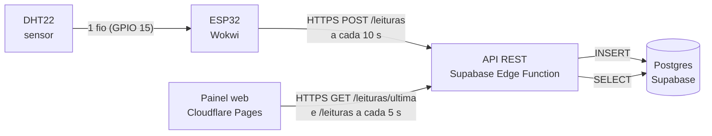

# Monitoramento IoT de Câmara Fria

Sistema IoT que monitora a **temperatura** e a **umidade** de uma câmara fria de perecíveis.
Um ESP32 com sensor DHT22 (simulado no Wokwi) envia as leituras por HTTPS para uma API REST
(Supabase Edge Function), que grava tudo no banco do Supabase. Um painel web publicado no
Cloudflare Pages consulta a API e mostra valor atual, histórico e alertas.

Trabalho da disciplina de **Arquitetura de Computadores**, UNIMAR.

| Item | Link |
|---|---|
| Simulação no Wokwi | https://wokwi.com/projects/480963320885095425 |
| Painel publicado | https://camara-fria-iot.pages.dev |
| API (base) | `https://sbrkemuvnjngcpzmvykx.supabase.co/functions/v1/api` |
| Vídeo de demonstração | _link a adicionar_ |

## Arquitetura (Opção B: envio direto por HTTPS)



**Problema:** perecíveis precisam ficar entre 0 °C e 8 °C, com umidade controlada.
**Grandezas:** temperatura (°C) e umidade relativa (%).
**Coleta:** uma amostra a cada 2 s; a média das últimas 5 é enviada à API a cada 10 s.
**Alerta:** temperatura acima de 8 °C **ou** umidade acima de 70%. O alerta só é desligado quando a temperatura fica abaixo de 7,5 °C e a umidade abaixo de 68% (histerese, para o alerta não ficar ligando e desligando perto do limite).
**Atuador (opcional):** LED vermelho = alerta; LED verde = transmissão ativa.

## Estrutura do repositório

```
wokwi/
  sketch.ino            código do ESP32
  diagram.json          circuito (ESP32, DHT22, 2 LEDs, botão)
  libraries.txt         biblioteca "DHT sensor library for ESPx"
  secrets.example.h     modelo do arquivo de credenciais (o secrets.h real não vai pro Git)
supabase/
  schema.sql            estrutura do banco (tabela leituras + índice + RLS)
  functions/api/index.ts  API REST (Edge Function)
  config.toml           verify_jwt = false para a função
site/
  index.html, style.css, app.js   painel
  config.js             URL da API e intervalos
testes/
  testar_api.sh         testes da API com curl
```

## Como reproduzir

### 1. Banco (Supabase)
1. Crie um projeto em <https://supabase.com> (plano gratuito).
2. Abra **SQL Editor → New query**, cole o conteúdo de `supabase/schema.sql` e clique em **Run**.
3. Anote o **Project ref**, que é o trecho `xxxx` da URL `https://xxxx.supabase.co` (fica em Project Settings).

### 2. API (Edge Function)
**Pelo painel do Supabase (sem instalar nada):**
1. **Edge Functions → Secrets**: crie o segredo `DEVICE_TOKEN` com um valor longo e aleatório (ex.: gerado em <https://www.uuidgenerator.net>).
2. **Edge Functions → Deploy a new function → Via Editor**: dê o nome **`api`**, apague o código de exemplo, cole o conteúdo de `supabase/functions/api/index.ts` e clique em **Deploy**.
3. Nas configurações da função, **desligue a verificação de JWT** ("Enforce JWT verification" / "Verify JWT"). A escrita continua protegida pelo `DEVICE_TOKEN`.
4. Teste no navegador: `https://sbrkemuvnjngcpzmvykx.supabase.co/functions/v1/api/status` deve retornar `{"ok":true,...}`.

**Ou pela CLI:**
```bash
supabase link --project-ref SEU_PROJECT_REF
supabase secrets set DEVICE_TOKEN=seu-token
supabase functions deploy api --no-verify-jwt
```

### 3. Sensor (Wokwi)
1. Abra <https://wokwi.com/projects/new/esp32>.
2. Substitua `sketch.ino` e `diagram.json` pelos arquivos da pasta `wokwi/`.
3. Na aba **Library Manager**, adicione **DHT sensor library for ESPx**.
4. Crie um arquivo novo chamado **`secrets.h`** com base em `secrets.example.h`, preenchendo `API_URL` e `DEVICE_TOKEN`.
5. Clique em ▶. O monitor serial deve mostrar `[API] #1 HTTP 201 ...` a cada 10 s.
6. Salve o projeto e copie o link.

### 4. Painel (Cloudflare Pages)
1. Em `site/config.js`, troque `SEU_PROJECT_REF` pelo seu Project ref e faça commit.
2. Cloudflare → **Workers & Pages → Create → Pages → Connect to Git**, escolha este repositório.
3. Build command: *(vazio)* · Build output directory: **`site`** → Deploy.
4. (Alternativa sem Git: **Upload assets** e arrastar a pasta `site`.)

### 5. Testes rápidos da API
```bash
API=https://sbrkemuvnjngcpzmvykx.supabase.co/functions/v1/api TOKEN=seu-token bash testes/testar_api.sh
```

## Endpoints da API

| Método | Rota | O que faz |
|---|---|---|
| `POST` | `/leituras` | Recebe leituras do dispositivo. Exige o header `x-device-token`. Retorna `201`. |
| `GET` | `/leituras/ultima?device_id=camara-01` | Leitura mais recente de cada grandeza, com os limites de alerta e a hora do servidor. |
| `GET` | `/leituras?device_id=camara-01&grandeza=temperatura&limite=60` | Histórico, do mais novo para o mais antigo (`grandeza` é opcional; `limite` vai até 500). |
| `GET` | `/status` | Teste de disponibilidade. |

Exemplo de envio do ESP32:
```json
{
  "device_id": "camara-01",
  "alerta": false,
  "leituras": [
    { "grandeza": "temperatura", "valor": 4.6, "unidade": "°C" },
    { "grandeza": "umidade", "valor": 55.0, "unidade": "%" }
  ]
}
```
A API valida o `device_id`, a grandeza e a faixa do valor (temperatura de -40 a 80 °C, umidade de 0 a 100%), e responde `400`/`422` quando algo está errado.

## Roteiro de testes (para o vídeo)

| # | Teste | Como fazer | Resultado esperado |
|---|---|---|---|
| 1 | Fluxo completo | Rodar o Wokwi com o painel aberto | Monitor serial `HTTP 201`, linha nova em `/leituras`, valor no painel |
| 2 | Alterar leitura | Clicar no DHT22 no Wokwi e mudar a temperatura para 5 °C | Em até cerca de 15 s o painel mostra o novo valor |
| 3 | Alerta | Subir a temperatura para 10 °C (ou a umidade para 80%) | LED vermelho aceso, banner vermelho no painel, linha "Alerta" na tabela |
| 4 | Fim do alerta (histerese) | Baixar para 7,8 °C e depois para 7 °C | Em 7,8 °C o alerta continua; em 7 °C ele desliga |
| 5 | Interrupção | Apertar o botão "Pausar TX" (ou parar a simulação) | Depois de 30 s o painel mostra "Dados desatualizados" |
| 6 | Retomada | Apertar o botão de novo (ou dar ▶) | O painel volta para "Recebendo dados" |
| 7 | Painel fechado | Fechar o painel, deixar o Wokwi rodando por 1 a 2 min e reabrir | O histórico mostra as leituras do período em que o painel estava fechado |
| 8 | Chegada na API | Abrir `/leituras?limite=5` no navegador, ou **Edge Functions → api → Logs** | Mostra os registros `recebido camara-01: temperatura=...` |

## Segurança e credenciais
- `secrets.h` (URL e token do dispositivo) está no `.gitignore`; o repositório tem só o `secrets.example.h`.
- A `service_role key` do Supabase fica **apenas** dentro da Edge Function (variável de ambiente automática). Ela nunca aparece no ESP32 nem no site.
- A tabela tem RLS ativado e nenhuma policy, então ninguém lê ou grava direto pela API pública do Supabase. Todo acesso passa pela Edge Function.
- O painel só usa rotas `GET` (leitura). Para gravar, é obrigatório o `x-device-token`.

## Limitações
- O ESP32 usa `setInsecure()` e não valida o certificado TLS da API (aceitável na simulação; em produção usaria o certificado raiz).
- Projetos compartilhados no Wokwi ficam públicos, então o `secrets.h` fica visível para quem abrir o link. Por isso o token só permite inserir dados simulados e pode ser trocado depois da avaliação.
- Se a rede cair, as leituras desse período se perdem, porque o ESP32 não guarda fila local.
- O painel atualiza por polling (a cada 5 s), não em tempo real (WebSocket/MQTT).
- O DHT22 tem precisão de ±0,5 °C e ±2 a 5% de UR.

## Integrantes
| Nome | Contribuição |
|---|---|
| Luis Filipe Seixas de Souza | Definição do problema, banco e API (Supabase), repositório |
| Felipe Traskini Rocha | Simulação no Wokwi e firmware do ESP32 |
| Samuel Alves | Painel web e publicação no Cloudflare Pages |
| Davi Samuel | Testes, vídeo de demonstração e relatório |
# Monitoramento IoT de Câmara Fria

Sistema IoT que monitora a **temperatura** e a **umidade** de uma câmara fria de perecíveis.
Um ESP32 com sensor DHT22 (simulado no Wokwi) envia as leituras por HTTPS para uma API REST
(Supabase Edge Function), que grava tudo no banco do Supabase. Um painel web publicado no
Cloudflare Pages consulta a API e mostra valor atual, histórico e alertas.

Trabalho da disciplina de **Arquitetura de Computadores**, UNIMAR.

| Item | Link |
|---|---|
| Simulação no Wokwi | _link a adicionar_ |
| Painel publicado | https://camara-fria-iot.pages.dev |
| API (base) | `https://sbrkemuvnjngcpzmvykx.supabase.co/functions/v1/api` |
| Vídeo de demonstração | _link a adicionar_ |

## Arquitetura (Opção B: envio direto por HTTPS)


**Problema:** perecíveis precisam ficar entre 0 °C e 8 °C, com umidade controlada.
**Grandezas:** temperatura (°C) e umidade relativa (%).
**Coleta:** uma amostra a cada 2 s; a média das últimas 5 é enviada à API a cada 10 s.
**Alerta:** temperatura acima de 8 °C **ou** umidade acima de 70%. O alerta só é desligado quando a temperatura fica abaixo de 7,5 °C e a umidade abaixo de 68% (histerese, para o alerta não ficar ligando e desligando perto do limite).
**Atuador (opcional):** LED vermelho = alerta; LED verde = transmissão ativa.

## Estrutura do repositório

```
wokwi/
  sketch.ino            código do ESP32
  diagram.json          circuito (ESP32, DHT22, 2 LEDs, botão)
  libraries.txt         biblioteca "DHT sensor library for ESPx"
  secrets.example.h     modelo do arquivo de credenciais (o secrets.h real não vai pro Git)
supabase/
  schema.sql            estrutura do banco (tabela leituras + índice + RLS)
  functions/api/index.ts  API REST (Edge Function)
  config.toml           verify_jwt = false para a função
site/
  index.html, style.css, app.js   painel
  config.js             URL da API e intervalos
testes/
  testar_api.sh         testes da API com curl
```

## Como reproduzir

### 1. Banco (Supabase)
1. Crie um projeto em <https://supabase.com> (plano gratuito).
2. Abra **SQL Editor → New query**, cole o conteúdo de `supabase/schema.sql` e clique em **Run**.
3. Anote o **Project ref**, que é o trecho `xxxx` da URL `https://xxxx.supabase.co` (fica em Project Settings).

### 2. API (Edge Function)
**Pelo painel do Supabase (sem instalar nada):**
1. **Edge Functions → Secrets**: crie o segredo `DEVICE_TOKEN` com um valor longo e aleatório (ex.: gerado em <https://www.uuidgenerator.net>).
2. **Edge Functions → Deploy a new function → Via Editor**: dê o nome **`api`**, apague o código de exemplo, cole o conteúdo de `supabase/functions/api/index.ts` e clique em **Deploy**.
3. Nas configurações da função, **desligue a verificação de JWT** ("Enforce JWT verification" / "Verify JWT"). A escrita continua protegida pelo `DEVICE_TOKEN`.
4. Teste no navegador: `https://sbrkemuvnjngcpzmvykx.supabase.co/functions/v1/api/status` deve retornar `{"ok":true,...}`.

**Ou pela CLI:**
```bash
supabase link --project-ref SEU_PROJECT_REF
supabase secrets set DEVICE_TOKEN=seu-token
supabase functions deploy api --no-verify-jwt
```

### 3. Sensor (Wokwi)
1. Abra <https://wokwi.com/projects/new/esp32>.
2. Substitua `sketch.ino` e `diagram.json` pelos arquivos da pasta `wokwi/`.
3. Na aba **Library Manager**, adicione **DHT sensor library for ESPx**.
4. Crie um arquivo novo chamado **`secrets.h`** com base em `secrets.example.h`, preenchendo `API_URL` e `DEVICE_TOKEN`.
5. Clique em ▶. O monitor serial deve mostrar `[API] #1 HTTP 201 ...` a cada 10 s.
6. Salve o projeto e copie o link.

### 4. Painel (Cloudflare Pages)
1. Em `site/config.js`, troque `SEU_PROJECT_REF` pelo seu Project ref e faça commit.
2. Cloudflare → **Workers & Pages → Create → Pages → Connect to Git**, escolha este repositório.
3. Build command: *(vazio)* · Build output directory: **`site`** → Deploy.
4. (Alternativa sem Git: **Upload assets** e arrastar a pasta `site`.)

### 5. Testes rápidos da API
```bash
API=https://sbrkemuvnjngcpzmvykx.supabase.co/functions/v1/api TOKEN=seu-token bash testes/testar_api.sh
```

## Endpoints da API

| Método | Rota | O que faz |
|---|---|---|
| `POST` | `/leituras` | Recebe leituras do dispositivo. Exige o header `x-device-token`. Retorna `201`. |
| `GET` | `/leituras/ultima?device_id=camara-01` | Leitura mais recente de cada grandeza, com os limites de alerta e a hora do servidor. |
| `GET` | `/leituras?device_id=camara-01&grandeza=temperatura&limite=60` | Histórico, do mais novo para o mais antigo (`grandeza` é opcional; `limite` vai até 500). |
| `GET` | `/status` | Teste de disponibilidade. |

Exemplo de envio do ESP32:
```json
{
  "device_id": "camara-01",
  "alerta": false,
  "leituras": [
    { "grandeza": "temperatura", "valor": 4.6, "unidade": "°C" },
    { "grandeza": "umidade", "valor": 55.0, "unidade": "%" }
  ]
}
```
A API valida o `device_id`, a grandeza e a faixa do valor (temperatura de -40 a 80 °C, umidade de 0 a 100%), e responde `400`/`422` quando algo está errado.

## Roteiro de testes (para o vídeo)

| # | Teste | Como fazer | Resultado esperado |
|---|---|---|---|
| 1 | Fluxo completo | Rodar o Wokwi com o painel aberto | Monitor serial `HTTP 201`, linha nova em `/leituras`, valor no painel |
| 2 | Alterar leitura | Clicar no DHT22 no Wokwi e mudar a temperatura para 5 °C | Em até cerca de 15 s o painel mostra o novo valor |
| 3 | Alerta | Subir a temperatura para 10 °C (ou a umidade para 80%) | LED vermelho aceso, banner vermelho no painel, linha "Alerta" na tabela |
| 4 | Fim do alerta (histerese) | Baixar para 7,8 °C e depois para 7 °C | Em 7,8 °C o alerta continua; em 7 °C ele desliga |
| 5 | Interrupção | Apertar o botão "Pausar TX" (ou parar a simulação) | Depois de 30 s o painel mostra "Dados desatualizados" |
| 6 | Retomada | Apertar o botão de novo (ou dar ▶) | O painel volta para "Recebendo dados" |
| 7 | Painel fechado | Fechar o painel, deixar o Wokwi rodando por 1 a 2 min e reabrir | O histórico mostra as leituras do período em que o painel estava fechado |
| 8 | Chegada na API | Abrir `/leituras?limite=5` no navegador, ou **Edge Functions → api → Logs** | Mostra os registros `recebido camara-01: temperatura=...` |

## Segurança e credenciais
- `secrets.h` (URL e token do dispositivo) está no `.gitignore`; o repositório tem só o `secrets.example.h`.
- A `service_role key` do Supabase fica **apenas** dentro da Edge Function (variável de ambiente automática). Ela nunca aparece no ESP32 nem no site.
- A tabela tem RLS ativado e nenhuma policy, então ninguém lê ou grava direto pela API pública do Supabase. Todo acesso passa pela Edge Function.
- O painel só usa rotas `GET` (leitura). Para gravar, é obrigatório o `x-device-token`.

## Limitações
- O ESP32 usa `setInsecure()` e não valida o certificado TLS da API (aceitável na simulação; em produção usaria o certificado raiz).
- Projetos compartilhados no Wokwi ficam públicos, então o `secrets.h` fica visível para quem abrir o link. Por isso o token só permite inserir dados simulados e pode ser trocado depois da avaliação.
- Se a rede cair, as leituras desse período se perdem, porque o ESP32 não guarda fila local.
- O painel atualiza por polling (a cada 5 s), não em tempo real (WebSocket/MQTT).
- O DHT22 tem precisão de ±0,5 °C e ±2 a 5% de UR.

## Integrantes


Luis Filipe Seixas de Souza, Felipe Traskini Rocha, Samuel Alves vieira, Davi Samuel Rodrigues de Oliveira

